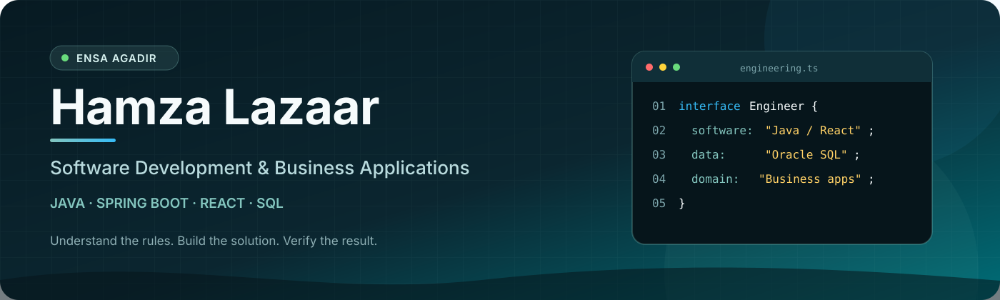
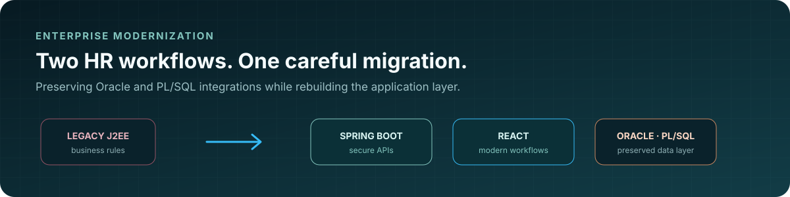
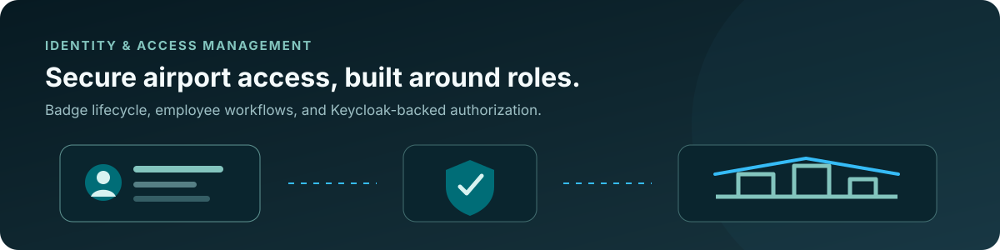
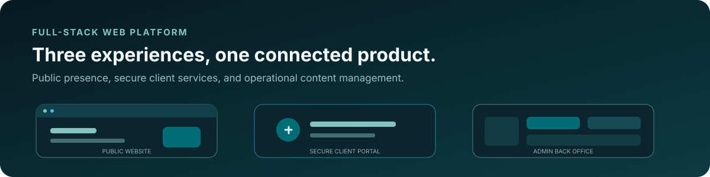

  

   
  
  

# Hamza Lazaar

**Software Engineer | Software Development & Business Applications**

[Portfolio](https://lazaar.netlify.app) · [LinkedIn](https://www.linkedin.com/in/hamza-lazaar1) · Casablanca, Morocco

I am an ENSA Agadir engineering graduate with a full-stack background in **Java/Spring Boot and React/TypeScript**. My work connects business rules, application development, data and testing.

I currently work as a **junior technical-functional consultant at Perenity Software**, where I am building knowledge of financial applications and asset-management processes. My onboarding includes Oracle SQL exercises, financial calculations and technical and functional presentations.

## 🎯 What I bring

- **Business application modernization:** reverse-engineering existing rules and implementing workflows, calculations and access controls.
- **Software development:** Spring Boot APIs, React interfaces, authentication and automated tests.
- **SQL and data analysis:** querying business data and interpreting results in their functional context.
- **A growing financial domain foundation:** securities transactions, portfolio valuation, acquisition cost and realized/unrealized gains and losses.

## 💼 Experience

### Perenity Software - Junior Technical-Functional Consultant

**October 2026 – present · Casablanca**

Currently in training on financial applications and business processes. Training work includes:

- Oracle SQL queries on securities positions, prices, cash movements and valuation history.
- An Excel calculator covering FIFO and weighted-average acquisition cost and gains/losses.
- Presentations explaining transactions and calculation methods.

### VOID Agency - HR Process Modernization for Barid Al-Maghrib

**Final-year internship · February-July 2026 · Casablanca**

Modernized two HR processes, overtime and travel allowances, from a Java EE monolith to **Spring Boot 3 and React/TypeScript**, retaining the Oracle database.

- Reverse-engineered calculation rules, caps, access rights and hierarchical approvals.
- Implemented workflows, traceability, batch processing and PDF exports.
- Built unit and integration tests, complemented by end-to-end and performance tests; backend coverage exceeded 80%.
- Used Prometheus and Grafana for observability.

**Java · Spring Boot · React · TypeScript · Oracle · JUnit · Mockito**

Enterprise source code and business data are confidential.

## 🚀 Selected projects

### Badge & Airport Access Management

**Royal Air Maroc · Application internship · 2025**

A full-stack application covering employee badges, time-bounded airport access and requests, with separate administrator and employee experiences. Built with Spring Boot, React/TypeScript, PostgreSQL and Keycloak.

[Backend](https://github.com/hamza-lzr/badgesApp) · [Frontend](https://github.com/hamza-lzr/badges-app-frontend)

### Dirham o Sserf

**Personal project**

A React currency converter designed around Moroccan usage: foreign currencies, dirhams, ryals and francs. Features include API integration, cached rates, offline estimates, freshness indicators and accessibility support.

[Repository](https://github.com/hamza-lzr/dirham-app)

### Ralydev Web Platform

**Ralydev Technology · Academic internship · 2025**

A public website, JWT-secured client portal and administrative back office, built with Spring Boot, React/TypeScript and PostgreSQL. Features include content management and customer-request tracking.

Internship project; source code is not publicly available.

## 🛠️ Technical foundation

<table>
  <tr>
    <td valign="top" width="50%">
      <strong>Backend & APIs</strong>  
      
      
      
      
    </td>
    <td valign="top" width="50%">
      <strong>Frontend</strong>  
      
      
      
      
    </td>
  </tr>
  <tr>
    <td valign="top" width="50%">
      <strong>Data & Security</strong>  
      
      
      
      
    </td>
    <td valign="top" width="50%">
      <strong>Testing & Delivery</strong>  
      
      
      
      
      
      
    </td>
  </tr>
  <tr>
    <td valign="top" width="50%">
      <strong>Tools & Observability</strong>  
      
      
      
      
      
      
    </td>
    <td valign="top" width="50%">
      <strong>Business Applications</strong>  
      
      
      
      
    </td>
  </tr>
</table>

Spring Data JPA/Hibernate · OAuth2/OIDC · role-based access control

## 🧭 How I approach a problem

1. Understand the process and the expected business result.
2. Make the rules explicit and inspect the relevant data.
3. Implement or configure the solution within my scope.
4. Verify the result with representative cases and document the outcome.

**Languages:** Arabic (native), French (C2 TCF), English (advanced).

   
  <strong>Let’s connect</strong>
    
  
  
    
  Casablanca, Morocco · Software development · Business applications · SQL

